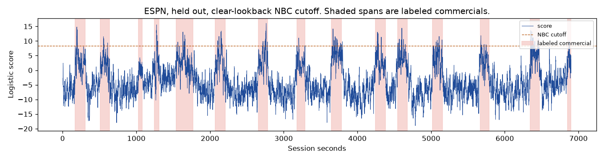
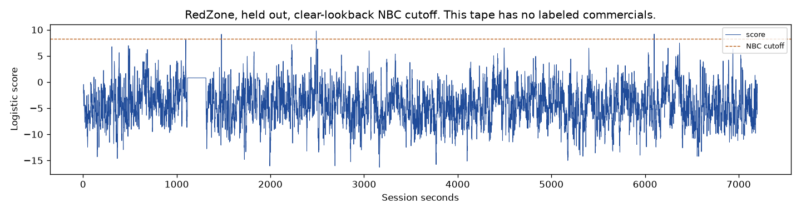

# Clear-lookback ceiling

A line set only by show seconds whose five-second lookback contains no commercial still cuts every held-out tape. ESPN loses 1.72 program seconds, Prime loses 20.336, and RedZone loses 4.0. The live mute was not changed. The sealed tapes were not opened. The two earlier lines, 12.155 and 9.893, were not moved.

The head is the same logistic fit on Sept 9 NBC and Sept 13 NBC. Of the entirely-program seconds on those two games, 15,337 have a clear lookback and 200 still contain a labeled commercial in the five seconds before the decision. The highest clear second is Sept 13 NBC, `hush_20260913_210542`, session clock 11412, score 8.285. It is 1,591 seconds after the previous break. The frozen AudioSet head calls it Music at 0.29 and Speech at 0.22. The cutoff is one step above that second: **8.285**. The 200 contaminated seconds were not allowed to set it. Their highest score is 9.893.

## What the line does

| Broadcast | Role | Commercial seconds marked | Commercial seconds missed | Program seconds marked | Interruptions | Starts marked | Median start delay |
| --- | --- | ---: | ---: | ---: | ---: | ---: | ---: |
| Sept 9 NBC | fit | 431.0 | 2,418.911 | 0 | 0 | 20 of 20 | 13.243 s |
| Sept 13 NBC | fit | 321.779 | 2,730.678 | 2.221 | 3 | 19 of 21 | 18.798 s |
| Sept 14 ESPN | held out | 186.28 | 1,617.767 | 1.72 | 3 | 14 of 15 | 11.008 s |
| Sept 24 Prime | held out | 237.664 | 1,426.691 | 20.336 | 16 | 13 of 13 | 18.756 s |
| Sept 13 RedZone | held out | 0 | 0 | 4.0 | 3 | no breaks | — |

Sept 13 is cut by a second the ceiling refused to use. The longest fit-game cut is 7754–7756, 1.686 program seconds. That decision second overlaps a labeled commercial, and its lookback is five seconds of the ad. Its score is above 8.285, so the line still covers it.

The held-out cuts are not that boundary. ESPN's longest is `hush_20260914_212529`, 3797–3798, 1 program second, 11.8 seconds after the previous break, with no commercial in the lookback. The AudioSet name is Music at 0.26. Prime's longest is `hush_20260924_220624`, 6331–6334, 3 program seconds, 150 seconds after the previous break, clear lookback, Music at 0.31. RedZone has no labeled commercials. Its longest cut is `hush_20260913_150934`, 1477–1479, 2 program seconds, and the AudioSet name is Speech at 0.33. The clips were not copied.

Starts arrive sooner than they did at 12.155, and they still do not hold. ESPN's median delay is 11.0 seconds, then 1,324 commercial seconds play before the labels end. Prime's median delay is 18.8 seconds, then 1,130 commercial seconds play early. One Prime break is still above the line when its label ends.

## October, already inspected

| Broadcast | Commercial seconds marked | Program seconds marked | Interruptions |
| --- | ---: | ---: | ---: |
| Oct 8 Prime Video | 391.774 | 26.226 | 12 |
| Oct 10 cable | 117.0 | 88.0 | 32 |
| Oct 11 afternoon | 57.847 | 4.153 | 3 |
| Oct 11 night | 65.766 | 304.234 | 139 |
| Oct 12 MNF | 314.844 | 14.156 | 9 |

Oct 11 night's longest cut is `hush_20261011_204300`, 12143–12153, 10 program seconds, inside 304 seconds across 139 interruptions.

## Where the three lines land

| Cutoff | How it was set | ESPN program seconds | Prime program seconds | RedZone program seconds | ESPN commercial seconds |
| --- | --- | ---: | ---: | ---: | ---: |
| 12.155 | any second that touches the show | 0 | 0 | 0 | 28.0 |
| 9.893 | entirely program, lookback may still be the ad | 0 | 10.0 | 0 | 92.0 |
| 8.285 | entirely program, lookback clear of ads | 1.72 | 20.336 | 4.0 | 186.28 |

Each step down marks more of the ad and cuts more of a later broadcast. The published continuity collapse, left as it was, marks 12 of 13 evaluable ESPN starts inside 15 seconds, about 4.2 program collapses an hour, and 17 collapses on RedZone at 8.5 an hour. This line is quieter than that on RedZone and still hides the show there, and on Prime. A line that hides a held-out game has no accuracy.

The next measurement does not pick a fourth cutoff. On the two NBC games only, split clear program seconds and commercial seconds by the frozen AudioSet top name, and compare their score distributions inside Music and inside Speech. If show-music on NBC already reaches the commercial scores, no threshold on this head can separate them. If NBC show-music stays below this line, the failure is that later games are louder than the two NBC games, and a third game may enter the fit only after that count is written.

Numbers are in `results.json`. The reader is `experiments/measurement/supervised_clear_ceiling_001.py`.
