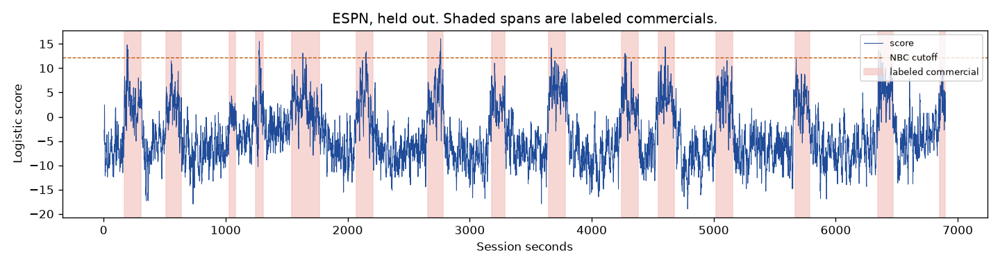
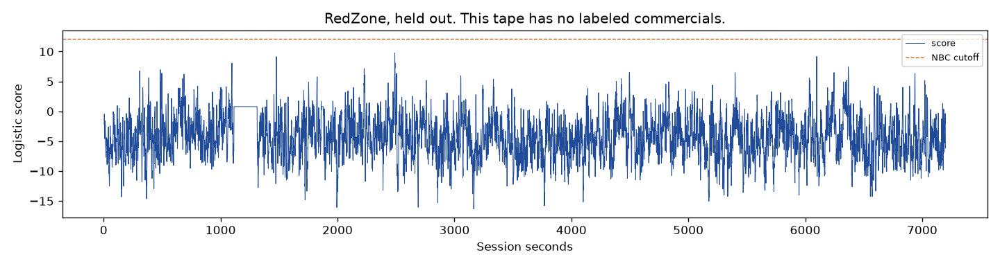

# Supervised scores, two NBC games held out of the test

A logistic head on cached 5-second AST windows, fit only on Sept 9 NBC (`hush_20260909_213047`) and Sept 13 NBC (`hush_20260913_210542`), does not mark the ads on the broadcasts it never trained on. At a cutoff that leaves those two NBC games on, ESPN, Sept 24 Prime, and RedZone lose 0 seconds of the show. They also keep almost every commercial second. The live mute was not changed. The sealed holdouts were not opened. October was scored with the same frozen cutoff and is already-inspected development.

The encoder is `MIT/ast-finetuned-audioset-10-10-0.4593`. Each score is the CLS token of audio that has already ended, zero-padded with silence when the window is shorter than the model's native 10.24 seconds. The head is logistic regression with balanced class weights, 21,400 labeled seconds (5,863 commercial, 15,537 program). On those fit rows its own boundary agrees with the label 92.73% of the time. That figure is not the mute line. The mute line is one step above the highest score that touches program audio on the two NBC games: **12.155**. It was locked before ESPN, Prime, RedZone, or October were scored. The reader is `experiments/measurement/supervised_heldout_001.py`.

Under that line the two fit games themselves contribute 63.0 and 57.0 commercial seconds, and 0 program seconds. Their commercial medians are 4.57 and 3.65. The safe line sits above the ads it was trained on.

## Held-out broadcasts

| Broadcast | Commercial seconds marked | Commercial seconds missed | Program seconds marked | Interruptions | Starts marked | Median start delay |
| --- | ---: | ---: | ---: | ---: | ---: | ---: |
| Sept 14 ESPN | 28.0 | 1,776.047 | 0 | 0 | 9 of 15 | 30.831 s |
| Sept 24 Prime | 39.0 | 1,625.355 | 0 | 0 | 9 of 13 | 38.188 s |
| Sept 13 RedZone | 0 | 0 | 0 | 0 | no breaks | — |

ESPN's commercial median is 3.46 and its program median is −6.37. Prime's are 4.38 and −4.49. RedZone has no commercials; its program median is −4.17, and the score stays under the NBC line for the whole tape. The middle of the score separates advertising from the show. The line required to leave the NBC games on does not.

A marked start is a labeled break that crosses the line at least once. The delay is from the labeled start until that first second. ESPN's 9 crossings arrive a median 30.8 seconds late. Prime's 9 arrive a median 38.2 seconds late. Six ESPN breaks and four Prime breaks never cross.

The return delay is 0 on every ESPN break and on 12 of 13 Prime breaks, and one Prime break is still above the line when its label ends. Zero here means the score has already fallen before the labeled end. It is not a recognized return. On the breaks that do cross, ESPN then plays 754.274 commercial seconds before the label ends, and Prime plays 705.461. The crossings are short spikes inside the ad.

## October, already inspected

These five tapes were already used in earlier development. The cutoff was not moved for them. Four of the five lose program audio.

| Broadcast | Commercial seconds marked | Commercial seconds missed | Program seconds marked | Interruptions |
| --- | ---: | ---: | ---: | ---: |
| Oct 8 Prime Video | 64.0 | 2,578.141 | 5.0 | 5 |
| Oct 10 cable | 13.0 | 1,068.817 | 12.0 | 8 |
| Oct 11 afternoon | 5.0 | 977.955 | 1.0 | 1 |
| Oct 11 night | 7.0 | 619.389 | 31.0 | 19 |
| Oct 12 MNF | 40.0 | 2,904.327 | 0 | 0 |

Oct 11 night is the weak tape again. Its program median is −0.03, against a commercial median of 3.66. The same line that is quiet on September sits inside the show there.

## What the mistakes sound like

The held-out tapes have no program interruption to point at. The longest ESPN break the line never touches is `hush_20260914_212529`, session clock 5019.615–5157.320 (137.7 seconds). The longest untouched Prime break is `hush_20260924_220624`, 6028.840–6180.703 (151.9 seconds). The clips were not copied.

The worst program interruption under this line is on Oct 11 night, `hush_20261011_204300`, session clock 3008–3012, 4 program seconds inside a run of 31. Oct 10 cable, `hush_20261010_222400`, loses 12 program seconds across 8 interruptions. Oct 8's worst single cut is 377–378, one second. Oct 11 afternoon's is 832–833, one second.

## The five questions

1. **Does it separate the held-out games?** The medians do. ESPN ads sit near 3.5 and the show near −6.4. A cutoff that leaves the two NBC games on does not use that gap. It marks 28 ESPN seconds and 39 Prime seconds, and it marks 0 program seconds on ESPN, Prime, and RedZone.

2. **Are starts and ends soon enough to matter?** No. The starts that fire are about half a minute late, and about a third of the held-out breaks never fire. The score drops again inside the break, hundreds of seconds before the labeled end.

3. **What are the worst mistakes?** On the held-out games, missing the break. The two long misses above are whole pods the line never enters. On the already-inspected October tapes, cutting the show: 31 seconds on Oct 11 night, 19 separate interruptions, the longest of them 3008–3012.

4. **Is this more promising than the continuity collapse?** The published comparison, left as it was, marks 12 of 13 evaluable ESPN starts inside 15 seconds, about 4.2 program collapses an hour, and 17 collapses on RedZone (8.5 an hour). This line is quieter on those two tapes and catches fewer breaks, later. Quiet because it barely fires is not a better start signal.

5. **The single next experiment.** On the two NBC games only, list every program second whose score reaches the ceiling at 12.155 and listen to those seconds. Their presence is why a line that leaves the fit games on sits above the commercial medians. Count them and name what they are. Do not move the cutoff with ESPN, Prime, RedZone, or October. Do not start a mute from this head.

Numbers are in `results.json`.
