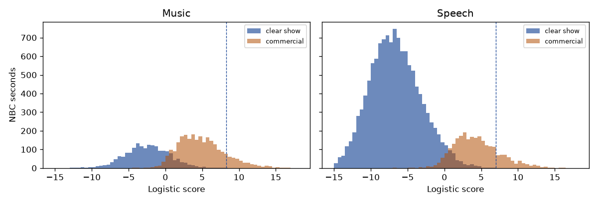

# Music and Speech on the two NBC games

Inside a single AudioSet name, the show and the ads still overlap. A line that leaves every clear NBC show second on catches about one sixth of the ads with that name. A line that catches the typical ad passes a few dozen show seconds. No cutoff was chosen. Later broadcasts were not read. The live mute was not changed.

The head is the logistic fit on Sept 9 NBC and Sept 13 NBC. The name is the top class of the frozen AudioSet classifier on the same cached 5-second vector. That top class is a weak call: the median winning probability is 0.27 for show seconds named Music and 0.36 for show seconds named Speech. Clear show seconds are entirely program, with no labeled commercial in the five-second lookback. There are 15,337 of them and 5,863 commercial seconds. Music and Speech cover 14,368 of the clear show seconds and 5,265 of the commercial seconds. The other 969 show seconds and 598 commercial seconds have some other top name and are not in the table.

| Name | Clear show seconds | Show median | Show maximum | Commercial seconds | Commercial median | Commercial 95th | Ads above the show maximum | Show seconds above the ad median |
| --- | ---: | ---: | ---: | ---: | ---: | ---: | ---: | ---: |
| Music | 1,853 | −2.425 | 8.285 | 2,661 | 4.594 | 10.840 | 404 | 23 |
| Speech | 12,515 | −6.843 | 6.958 | 2,604 | 4.036 | 10.222 | 488 | 28 |

The middles are apart. Show music sits at −2.4 and ad music at 4.6. Show speech sits at −6.8 and ad speech at 4.0. No clear show second in either name reaches the 95th percentile of the ads with that name.

The tails cross. The loudest clear show-music second scores 8.285, which is above the middle of the music ads. Leaving that second on leaves 2,257 of 2,661 music ads unmarked. The same shape holds for Speech: 2,116 of 2,604 speech ads score at or below the loudest clear show-speech second. Splitting by name does not open a gap a threshold can use. Show music on these two games already reaches the commercial scores.

The 23 show-music seconds above the ad median are not one isolated spike. The loudest is the second that set the clear-lookback line, Sept 13 NBC `hush_20260913_210542` at 11412. Others on that tape sit near 1011–1124 and near 10151–11419. Sept 9 NBC adds 1263 and 3594. The loudest show-speech second is the same tape at 10445, score 6.958, with more of that tail at 10263, 11050, and 11419. The full lists are in `results.json`. The clips were not copied.

The next measurement is to hear those two Sept 13 stretches, 1011–1124 and 10151–11419, and say whether they are one repeated sound or ordinary pieces of the show. It does not move a cutoff, and it does not open a later game. If they are ordinary show, this head is finished as a commercial detector.

The reader is `experiments/measurement/supervised_name_scores_001.py`.
