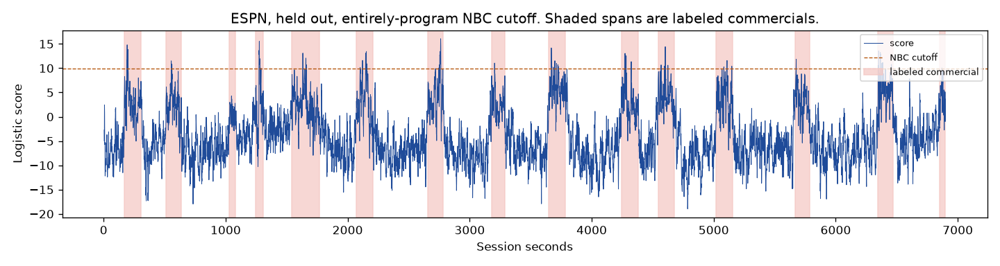
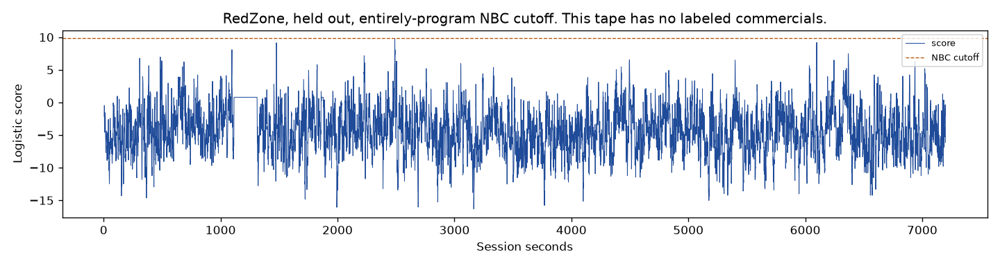

# Entirely-program ceiling

Taking the cutoff from seconds that are entirely the show, instead of from any second that merely touches it, cuts the held-out Prime game. The published line at 12.155 was not moved. The live mute was not changed. The sealed tapes were not opened.

The head is still the logistic fit on Sept 9 NBC and Sept 13 NBC. The new line is one step above the highest score whose covered second is entirely program: **9.893**. That second is Sept 13 NBC, `hush_20260913_210542`, session clock 7755. It sits one second after a mixed boundary whose lookback is five seconds of the ad. October did not choose the number.

## What the line does

| Broadcast | Role | Commercial seconds marked | Commercial seconds missed | Program seconds marked | Interruptions |
| --- | --- | ---: | ---: | ---: | ---: |
| Sept 9 NBC | fit | 208.0 | 2,641.911 | 0 | 0 |
| Sept 13 NBC | fit | 174.922 | 2,877.535 | 1.078 | 2 |
| Sept 14 ESPN | held out | 92.0 | 1,712.047 | 0 | 0 |
| Sept 24 Prime | held out | 117.0 | 1,547.355 | 10.0 | 8 |
| Sept 13 RedZone | held out | 0 | 0 | 0 | 0 |

Sept 13 loses show audio under a line built to leave entirely-program seconds on. The longer cut is 7754–7755, 0.686 program seconds, the mixed second just before the setter. The two cuts together are 1.078 seconds.

ESPN stays intact and marks 92 commercial seconds, against 28 under the published 12.155 line. Fourteen of 15 breaks cross, a median 26.5 seconds after the labeled start, and then the score falls inside the break: 1,195 commercial seconds play before those labels end. One ESPN break never crosses, 1029.664–1079.128.

Prime is the held-out failure. Ten program seconds, eight interruptions. The longest is `hush_20260924_220624`, session clock 5519–5521, 2 program seconds. The clip was not copied. Twelve of 13 Prime breaks cross, a median 33.9 seconds late, and the score has already fallen before the labeled end on 12 of them.

RedZone stays under the line for the whole tape.

## October, already inspected

| Broadcast | Commercial seconds marked | Program seconds marked | Interruptions |
| --- | ---: | ---: | ---: |
| Oct 8 Prime Video | 211.639 | 13.361 | 7 |
| Oct 10 cable | 62.0 | 40.0 | 17 |
| Oct 11 afternoon | 24.0 | 2.0 | 2 |
| Oct 11 night | 29.766 | 121.234 | 70 |
| Oct 12 MNF | 151.0 | 2.0 | 2 |

Oct 11 night again. The longest cut is `hush_20261011_204300`, 12144–12153, 9 program seconds, inside 121 seconds across 70 interruptions.

## Against the continuity collapse

The published comparison still stands: 12 of 13 evaluable ESPN starts inside 15 seconds, about 4.2 program collapses an hour, and 17 collapses on RedZone at 8.5 an hour. This line leaves ESPN and RedZone on, and it cuts 10 seconds of Prime. A line that hides a held-out game has no accuracy. It is not a substitute for that comparison, and it is not a mute.

The single next measurement is the same head and the same two NBC games, with the ceiling taken only from entirely-program seconds whose five-second lookback contains no labeled commercial. The highest such second already found is Sept 13 at 11412, score 8.285, Music, 1,591 seconds after the previous break. Lock that rule before reading the held-out scores again. If Prime or RedZone is cut, that is the result.

Numbers are in `results.json`. The reader is `experiments/measurement/supervised_program_ceiling_001.py`.
