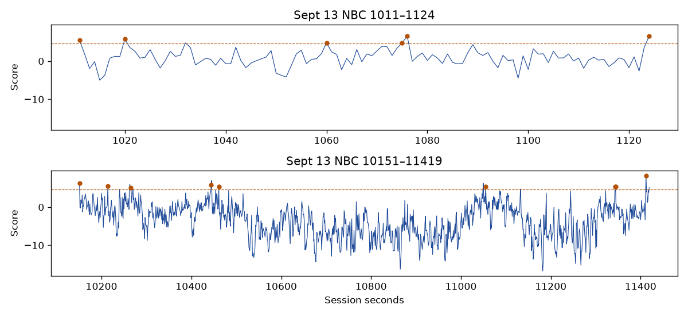

# The loud NBC show seconds are not one sound

The two Sept 13 stretches are ordinary stretches of the game with a few musical spikes in them. They are not a repeated recording. The logistic head is finished as a commercial detector. No cutoff was moved. No later game was opened. The live mute was not changed. The words were not transcribed.

The stretches were fixed before this listen: `hush_20260913_210542`, session clock 1011–1124 and 10151–11419. Inside them, a clear show second counts as one of the loud ones when its top AudioSet name is Music and its score reaches the commercial-music median, 4.594. That is the same median already measured on the two NBC games. There are 6 such seconds in the first stretch, 9 in the second, and 4 more on this tape at 3737–3765, outside either stretch. The fingerprint accept count stays 200. A copy of the first loud window matches itself at 511, so the count can see an exact repeat.

## Where they sit

The first stretch starts 92 seconds after the break that ends at 918.525, and it ends 423 seconds before the next break. The score spends most of that minute below the music-ad median. The six loud seconds are separate spikes, the highest at 1124, score 6.586.

The second stretch starts 330 seconds after the last labeled break on this tape, which ends at 9820.857. The nine loud seconds are spread across about twenty minutes. The highest is 11412, score 8.285, the second that set the clear-lookback line. The score between the spikes falls well below zero.

The other four seconds, 3737–3765, start 21 seconds after the break that ends at 3715.836. The lookback is clear of the ad. The highest score there is 7.342.

## They do not match each other

Across the 54 pairs that put one loud second from the first stretch against one from the second, the highest fingerprint score is 3. None reach 200. The highest score from any of these loud seconds against an ordinary show window, taken every 600 seconds of clear program on the same tape, is 0.

The scores that do reach 200 are neighboring seconds of the same spike: 1075–1076, 3737–3739, and 11343–11344. Those windows overlap. They are one moment heard twice, not a theme that returns later in the game.

The AST vectors agree. The mean cosine between the two stretches is 0.55. The mean cosine between the loud seconds and the ordinary show windows is 0.54. Ordinary show windows are more alike to each other, at 0.64, than the loud seconds are. The loud seconds are not a tighter cluster than the rest of the show.

The frozen AudioSet head is a weak name on these seconds. Median Music probability is 0.29 on the loud seconds and 0.09 on the ordinary show windows. Speech is 0.20 against 0.36. Crowd and applause stay near zero on both. The loud seconds are a bit more musical than the booth samples. They are not a separable sound.

## What this closes

A line that leaves these seconds on misses most of the ads, because the ads' own middle sits below 8.285. A line that catches the typical ad cuts these seconds, and the seconds are scattered through the show rather than one recording that could be subtracted. Three cutoffs and a split by AudioSet name already showed the same overlap. This listen says the overlap is the game, not a repeated sting.

The next measurement does not use this head. It is the spot-level fingerprint that has not been run: split labeled breaks at the interior cuts, enroll only pieces from earlier games, keep count 200, and require zero program seconds on the later game and on RedZone. If that also misses, the audio search on these tapes stops.

Numbers are in `results.json`. The reader is `experiments/measurement/supervised_stretch_001.py`. The clips were not copied.
